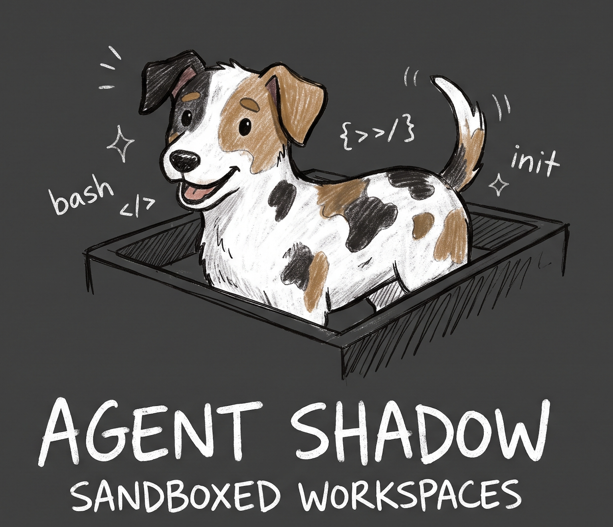

<p align="center">
  
</p>

# `agent-shadow`

> **S**andboxed **H**ost-**A**gnostic **D**istros, **O**rchestrated **W**orkspaces  
> *Easy to **wash**: coding agents **do** their work in an isolated **shadow** workspace.*

A `zsh` command-line tool for running AI coding agents (`claude`, `codex`, `agy`, `opencode`, or a plain `bash` shell) inside Apple containers on macOS 26+. Each container is a small Linux VM that sees only your project folder. Toolchains installed with `mise` are shared between projects and mounted read-only. The only requirement besides macOS is Apple's `container` CLI.

---

## Requirements

- **macOS 26+ (Tahoe)** (required for Apple Container user-defined networks)
- **Apple `container` CLI** (the installer offers to install it if missing)

---

## Installation

```bash
brew tap hdandekar/agent-shadow https://github.com/hdandekar/agent-shadow
brew install agent-shadow          # upgrade later with: brew upgrade agent-shadow
```
agent-shadow is not in homebrew-core: the tap is this
repository. Because it is named `agent-shadow` rather than `homebrew-agent-shadow`, `brew tap` needs the URL;
the tap is still called `hdandekar/agent-shadow`. Homebrew downloads the tagged source archive and checks it
against the SHA-256 in `Formula/agent-shadow.rb`. It also installs Apple's `container` if you don't have it.

**From a checkout (for development):** `./install.sh` installs that copy into `~/.local/share/agent-shadow`
and links `~/.local/bin/agent-shadow` (or `$XDG_BIN_HOME`). Run it again after `git pull`.

**Remove:** `agent-shadow uninstall` (see [Workflow 7](#workflow-7-resetting-agent-memory-vs-clean-slate)), then
`brew uninstall agent-shadow` if you installed with Homebrew.

See [docs/SECURITY.md §8](docs/SECURITY.md#8-where-agent-shadow-and-its-images-come-from) for what is downloaded and trusted.

---

## Quick Start

1. **Build the base image (`ubuntu24`) and create the shared `mise-store` volume:**
   ```bash
   agent-shadow init
   ```

2. **Register a project workspace** (attaches to shared `shadow-net` and creates persistent `/root` volume `home-<slug>`):
   ```bash
   agent-shadow register ~/work/my-project
   ```

   *(Optional: `--isolated` gives the project its own network without direct internet; outbound HTTPS then needs your approval, see Workflow 6.)*

3. **Install runtimes and agent CLIs with `mise`** (`tools` passes its arguments to `mise`):
   ```bash
   # `use -g` installs and puts the tool on PATH in every workspace
   agent-shadow tools use -g node@22
   agent-shadow tools use -g python@3.14
   agent-shadow tools use -g npm:@anthropic-ai/claude-code

   # Inspect installed toolchains
   agent-shadow tools ls
   ```

4. **Run an agent inside your workspace** (works from the registered root or any subdirectory):
   ```bash
   cd ~/work/my-project
   agent-shadow run claude
   ```

5. **Check system status, volumes, and registered workspaces:**
   ```bash
   agent-shadow doctor
   ```

---

## Everyday Workflows & Recipes

### Mental Model in 30 Seconds

```
Host (macOS Tahoe):
  ~/projects/my-app ───────────────┐ (Bind Mount)
                                   ▼
Container Sandbox:           /workspace   (Your project files live here)
                             /opt/mise    (Toolchains: Node, Python, Claude - READ-ONLY)
                             /root        (State: API keys, history, resume IDs - PERSISTENT)
```

1. **Your project files live at `/workspace`:** it is your Mac folder, so every change the agent makes is on your Mac right away.
2. **Toolchains live in `/opt/mise`, read-only:** shared by all projects. A session cannot change them; only `agent-shadow tools`, run on the Mac, can.
3. **Agent state lives in `/root`, read-write:** each project has its own volume (`home-<slug>`). Logins, history and session IDs survive between sessions, and so does anything else written there, including by packages the agent installs. `agent-shadow wash` resets it.

---

### Workflow 1: Running an AI Coding Agent

The container does not mount your Mac's home folder or SSH-key files, and it has no direct access to the macOS Keychain. It can read and change the registered project folder; network access depends on its configured network and may include services listening on reachable Mac interfaces. The agent's own API key is available inside the container (see [docs/SECURITY.md](docs/SECURITY.md#the-agents-own-api-key--login-token)).

```bash
# 1. Register your project folder (one-time setup per project)
agent-shadow register ~/projects/my-app

# 2. Install the agent CLI into the shared toolchain store (once)
agent-shadow tools use -g npm:@anthropic-ai/claude-code

# 3. Launch the agent inside your sandbox
cd ~/projects/my-app
agent-shadow run --env ANTHROPIC_API_KEY="$ANTHROPIC_API_KEY" claude

# 4. In another tab or afterwards, list outbound connections the container made
agent-shadow traffic

# 5. Review, commit and push from the Mac with repo hooks disabled
git diff
agent-shadow git commit -am "agent changes"
agent-shadow git push
```

> **Pushing happens on the Mac, not in the sandbox.** The image has **no SSH client** and no keys
> are mounted, so `git push`/`git fetch` over SSH inside the container fails with
> `error: cannot run ssh: No such file or directory`. That is deliberate (see
> [Why SSH Keys Are Never Mounted](#security-principles--threat-model)). Push from macOS with
> `agent-shadow git push`, which uses your Mac's SSH setup. Reading public repositories over
> HTTPS (`git clone https://…`) works inside the sandbox; on `--isolated` workspaces only for allowlisted hosts.

When the session ends, `agent-shadow` warns if the agent added or changed files that can run code on your Mac (git hooks, `.git/config`, `.envrc`, `.vscode/tasks.json`, `package.json`, `Makefile`, CI workflows, …):

```text
  ⚠ Files that can run code on your Mac changed since this session started:
       added     .git/hooks/pre-commit
       modified  package.json
```

Add your own globs (one per line) to `~/.config/agent-shadow/watch`, e.g. `pyproject.toml`, `gradlew`, `gradle/wrapper/*`.

---

### Workflow 2: Interactive Sandbox Shell (Try Code & Run Tests)

Open a shell in an Ubuntu 24.04 container to run commands, builds or tests:

```bash
cd ~/projects/my-app

# Launch an interactive bash shell in the sandbox
agent-shadow run bash
```

Inside the shell:
```bash
# Tools you installed with `agent-shadow tools use -g` are on PATH:
node --version

# Run your test suite or build:
npm test

# Deleting /root, /workspace or / by mistake is blocked (see docs/SECURITY.md §2):
rm -rf /root
```
Type `exit` to return to your Mac. Changes to project files stay in your Mac folder.

#### Using it without `mise`: what survives between sessions

`mise` is optional. After `register`, `agent-shadow run bash` gives you Ubuntu with `git`, `curl` and
`build-essential` (no Python or Node: install them with `mise` or yourself). Every `run` starts a **fresh container**,
so where you install something decides whether it is still there next time:

| Install with | Kept after `exit`? | Why |
| :--- | :--- | :--- |
| `apt-get install …` | ❌ No, reinstall each `run` | system files live in the throwaway container |
| `apt-get install …` inside `agent-shadow start` / `connect` | Until `agent-shadow stop` | same container for the whole `start` → `stop` lifetime |
| Installers that use your home folder, e.g. `curl -LsSf https://astral.sh/uv/install.sh \| sh`, then `uv python install`, `uv tool install …` | ✅ Yes, per workspace | `/root` is this workspace's own volume; `~/.local/bin` is on `PATH` |
| Files in `/workspace` | ✅ Yes | it's your project folder on the Mac |
| Packages added to the image (see [Customizing Images](#customizing-images)) | ✅ Yes, every workspace | baked into `agent-base` |

To make system packages permanent, add them to the image (see [Customizing Images](#customizing-images)).

`agent-shadow wash` empties `/root`, so it also removes everything you installed there.

---

### Workflow 3: Developing with Web Servers & Port Binding

Keep a dev server running in the background and test it in your Mac browser:

```bash
cd ~/projects/my-app

# 1. Start a persistent background container with port 3000 mapped to localhost:
agent-shadow start -p 3000:3000

# 2. Attach to the running background container at any time:
agent-shadow connect

# 3. Inside the container, start your web server:
npm run dev

# 4. Open http://localhost:3000 in a browser on your Mac

# 5. When finished, shut down the background container:
agent-shadow stop
```

---

### Workflow 4: Managing Tools & Runtimes (`mise`)

`agent-shadow tools <args>` runs `mise <args>` in a temporary container that can write to `mise-store`. It refuses to run while any agent container is running, because those mount the store read-only:

```bash
# Install AND activate runtimes for every workspace (`install` alone downloads but does not put them on PATH)
agent-shadow tools use -g node@22
agent-shadow tools use -g python@3.14
agent-shadow tools use -g java@temurin-21

# Download a version without activating it
agent-shadow tools install node@20

# List all installed tools and runtimes
agent-shadow tools ls

# Upgrade all tools or a specific tool (note `tools ls` first if you may want to go back)
agent-shadow tools upgrade node

# Go back after a bad upgrade: activate the exact version you had
agent-shadow tools use -g node@22.23.5

# Uninstall a runtime
agent-shadow tools uninstall python@3.12
```

All workspaces share one `mise-store`, so whatever `tools` installs reaches every project. If your team
wants to wait before taking brand-new releases, mise has its own setting for that
(`agent-shadow tools settings set minimum_release_age 3d`; off by default, exact versions are never held back).
agent-shadow does not set or require it. See the [mise settings](https://mise.jdx.dev/configuration/settings.html).

---

### Workflow 5: Reviewing Outbound Connections (`traffic`)

While a container runs, a background `tcpdump` records DNS lookups and new outbound TCP connections in
`/root/.traffic.log`. `agent-shadow traffic` shows the ones not on the allowlist (npm, PyPI, GitHub, LLM APIs, …
plus yours), matched exactly as the `--isolated` proxy matches it. Connections to your Mac (the network's
gateway) are always shown and labelled `(your Mac)`. The log is inside the container, so this is a record for review, not
protection: root in the container can edit it. To block traffic instead, use `--isolated` (Workflow 6).

```bash
# Show connections to hosts not on the allowlist:
agent-shadow traffic

# Show all recorded connections:
agent-shadow traffic --all

# Follow traffic live as the agent works:
agent-shadow traffic --follow

# Clear traffic log for a fresh session:
agent-shadow traffic --clear
```

---

### Workflow 6: Approving Outbound Network Access (`--isolated`)

Register with `--isolated` to put the workspace on its own Apple Container `--internal` network (`hostOnly`) and use a per-workspace approval proxy. In live tests on Apple Container 1.7.1, direct HTTP to numeric public IP `1.1.1.1:80` and direct HTTPS to `example.com` were blocked; approved HTTPS went through the proxy (`shadow-proxy-<slug>`), and non-allowlisted HTTPS was denied.

This is not a blanket network denylist: the destination allowlist applies to HTTP(S) requests that use the proxy, and the isolated container can still reach services listening on reachable Mac interfaces. A live test reached a temporary Mac service bound to `0.0.0.0` through the network gateway. The generated proxy rule `Allow <workspace-subnet>` controls which source clients may connect to the proxy; it does not allow `192.168.x.x` or `172.x.x.x` destination ranges. See [SECURITY.md §6](docs/SECURITY.md#6-outbound-network---isolated) for details.

```bash
agent-shadow register --isolated ~/work/client-app
cd ~/work/client-app
agent-shadow run claude
```

When the agent reaches a host that isn't allowlisted, a native macOS dialog asks you (30 s timeout → Deny):

```text
  Agent in workspace 'client-app' wants to reach:
      api.stripe.com
  Allow for this workspace?            [Deny]  [Allow]
```

Click **Allow**, then tell the agent to retry — no restart needed. Approvals apply to that workspace only.

```bash
agent-shadow egress list                    # approvals + proxy status
agent-shadow egress allow api.stripe.com    # approve without a dialog
agent-shadow egress revoke api.stripe.com
agent-shadow egress watch                   # dialogs for start/connect sessions (second terminal)
```

The allowlist = built-in registries & LLM APIs + `~/.config/agent-shadow/allowlist` (all workspaces) + per-workspace approvals.
An approval covers **exactly** the host you name: `astral.sh` does not cover `releases.astral.sh`. Use `'*.astral.sh'`
for a domain and all its subdomains. Entries may be hostnames, IPv4 literals, or a leading-`*.` domain pattern; CIDR destination ranges are not supported. This filter applies to requests sent through the proxy, not to other reachable services.

For one-off commands (`agent-shadow run bash -c '…'`), connections are shown as they happen, so you can tell a
slow download from a stuck one. A host blocked by a command that finished before the dialog could appear is listed at exit:

```text
[agent-shadow] Starting sandbox container…
  ↳ egress: connected to astral.sh
  ↳ egress: blocked releases.astral.sh
  ⚠ Blocked this session before it could be asked: releases.astral.sh
[agent-shadow]   Approve and re-run: agent-shadow egress allow releases.astral.sh   (or '*.astral.sh' for all its subdomains)
```

> Workspaces registered `--isolated` before this release have a network with internet access. `run` warns and shows how to recreate it.

---

### Workflow 7: Resetting Agent Memory vs. Clean Slate

```bash
# Scenario A: You want to wipe agent conversation history and start fresh,
# but KEEP all your project code and toolchains:
agent-shadow wash

# Scenario B: You want to remove a project from agent-shadow tracking:
agent-shadow unregister ~/projects/my-app

# Scenario C: Remove agent-shadow and its workspaces (asks first; --yes to skip the question):
agent-shadow uninstall             # keeps images, toolchains (mise-store) and shadow-net
agent-shadow uninstall --purge     # removes those too
brew uninstall agent-shadow        # then the program, if installed with Homebrew
```

`uninstall` removes the containers, `/root` volumes (`home-<slug>`) and `--isolated` networks of the
workspaces in your registry, their egress proxies and `~/.config/agent-shadow`; for a `./install.sh` copy
also the program itself.
It only touches what belongs to registered workspaces: another tool's container called `agent-…` or a volume
called `home-…` is left alone. It keeps what takes long to download again: the `agent-base`/`agent-proxy`
images (base image layers, apt packages), `mise-store` (your toolchains) and `shadow-net`, so a reinstall is
ready at once. Apple Container's guest kernel is Apple's: agent-shadow neither downloads nor removes it.

If an older version cached a kernel copy in `~/Library/Caches/agent-shadow/`, you can delete that folder.

---

### Workflow 8: Running Multiple Projects in Parallel

You can run agents for several projects at the same time, one per terminal tab:

```text
Terminal 1 (~/work/project-a)  ──►  agent-shadow run claude  ──► [agent-claude-project-a]
Terminal 2 (~/work/project-b)  ──►  agent-shadow run claude  ──► [agent-claude-project-b]
Terminal 3 (~/work/project-c)  ──►  agent-shadow run agy     ──► [agent-agy-project-c]
Terminal 4 (~/work/project-a)  ──►  agent-shadow run bash    ──► [agent-bash-project-a]
```

1. **One name per folder:** each registered folder gets a slug (e.g. `project-a`), used in container and volume names.
2. **Separate state:** `project-a` keeps its logins and history in `home-project-a`, `project-b` in `home-project-b`.
3. **Shared toolchains:** all projects use the same read-only `/opt/mise`, so runtimes are installed once.
4. **Found from the current folder:** `agent-shadow run` finds the project from the folder you are in (or any folder above it).
5. **Second session in the same project:** if that project's container is already running (`start`, or another `run bash`), `run` opens a new shell in it with `container exec` instead of starting another one. `run`, `start` and `connect` only reuse a running container if it is on the network the command asks for (the registered one, `--isolated` or `--network`); otherwise they refuse and tell you to `stop` it first.

---

## Commands

| Command | Description |
| :--- | :--- |
| `agent-shadow init [--distro NAME] [--subnet CIDR] [--force]` | Build `agent-base:<distro>` and `agent-proxy`, create `mise-store` and `shadow-net` (skips existing images unless `--force`). |
| `agent-shadow register [dir] [opts]` | Register a workspace directory (opts: `--distro`, `--isolated` or `--network NAME`, `--subnet`). Its slug is the folder name; a second folder with the same name gets the name plus 6 hex digits, so it never shares the first one's `/root`. |
| `agent-shadow unregister <dir>` | Remove a workspace from the registry; prints the commands to delete its volume and network. |
| `agent-shadow start [dir] [opts]` | Start a background container (for dev servers and published ports). |
| `agent-shadow connect [dir] [--isolated \| --network NAME]` | Open a shell in the workspace's background container (alias: `shell`). |
| `agent-shadow run [opts] <agent> [args...]` | Run an agent or shell in the workspace of the current folder. Options go before `<agent>`; everything after it is passed to the agent. |
| `agent-shadow stop [dir] [--all]` | Stop the workspace's background container (`--all`: every container and proxy of a registered workspace). |
| `agent-shadow wash [dir] [--force]` | Delete and recreate the workspace's `/root` volume (`home-<slug>`); asks first unless `--force`. |
| `agent-shadow tools [opts] <mise-args...>` | Run `mise <args>` with write access to `mise-store` (e.g. `use -g`, `install`, `ls`, `upgrade`). |
| `agent-shadow list` | List all registered workspaces and mapped distributions. |
| `agent-shadow traffic [dir] [opts]` | Show recorded outbound connections to hosts not on the allowlist (opts: `--all`, `--follow`, `--clear`). |
| `agent-shadow egress [dir] <sub>` | Outbound approval for `--isolated` workspaces: `list`, `allow <host>`, `revoke <host>`, `watch`. |
| `agent-shadow git <git-args...>` | Run `git` on the Mac with a fixed set of repository settings that run programs turned off (hooks, editor, pager, …; see below). Use it to commit and push agent work. |
| `agent-shadow doctor` | Check macOS version, the `container` service, images, volumes and registered folders. |

### `run` & `start` Options

- `--publish HOST:CONTAINER` (`-p`) — Publish a container port on the Mac, always on `127.0.0.1` (repeatable)
- `--env KEY[=VALUE]` — Pass an environment variable into the container (repeatable)
- `--env-file FILE` — Load environment variables from a file (e.g. `.env`)
- `--isolated` (`-i`) — Use the project's own host-only network (`shadow-<slug>-net`) with the approval proxy for this session; cannot be combined with `--network`
- `--network NAME` — Attach to a custom `container` network instead; custom networks are not assumed to be isolated
- `--distro NAME` (`-d`) — Override the distro image for the current session (default: `ubuntu24`)
- `--cpus N` — Set CPU limit (default: `4`)
- `--memory SIZE` (`-m`) — Set RAM limit (default: `4g`)

---

## Supported Distros

| Flag | Base Image | Shared Toolchain Volume | Status |
| :--- | :--- | :--- | :--- |
| `ubuntu24` *(default)* | `ubuntu:24.04` | `mise-store` | ✅ Supported |
| `ubuntu26` | `ubuntu:26.04` | `mise-store` | ✅ Supported |
| `debian`, `fedora`, `almalinux`, `rocky`, `alpine` | — | per family | ⏳ Planned ([ROADMAP](ROADMAP.md#issue-1-more-linux-distributions-fedora-almalinux-alpine-)) |

### Customizing Images

The image is built from [`lib/agent-shadow/image/Containerfile`](lib/agent-shadow/image/Containerfile). agent-shadow
depends on what is in it (mise and its paths, the traffic monitor, the entrypoint), so don't edit it: add your own
layers in `~/.config/agent-shadow/Dockerfile.<distro>.append`. `agent-shadow init` inserts that file before
`WORKDIR /workspace`. The default image has no compilers (mise installs prebuilt Node, Python and Java); a tool
that builds native code needs them added:

```bash
cat >> ~/.config/agent-shadow/Dockerfile.ubuntu24.append <<'EOF'
RUN apt-get update && apt-get install -y --no-install-recommends \
      build-essential libssl-dev zlib1g-dev libffi-dev libreadline-dev libyaml-dev jq ripgrep && \
    rm -rf /var/lib/apt/lists/*
EOF
agent-shadow init --force
```

When the template changes (an agent-shadow upgrade, or an edit to your `.append` file), `run`, `start` and
`doctor` say once that the image was built from an older template. Nothing is rebuilt until you run
`agent-shadow init --force`; existing images keep working, and your state is not in the image (`/root`,
toolchains and the project live in volumes and your Mac folder).

---

## Architecture & How Isolation Works

- **What agent-shadow does vs. mise:** agent-shadow creates the containers, networks and volumes; installing tools is left to `mise` (`agent-shadow tools` passes its arguments straight through).
- **Background containers (`start`, `connect`, `stop`):** one long-running container per workspace for dev servers; `connect` and `run` open shells or agents in it.
- **Resetting state (`wash`):** deletes and recreates the workspace's `/root` volume. Project files are not touched.
- **Git inside the container:** the image sets `safe.directory "*"` (avoids git's "dubious ownership" error on `/workspace`), and your Mac's global `user.name` / `user.email` are passed in as a fallback identity.
- **Environment variables:** `--env KEY[=VAL]` and `--env-file FILE` pass values in at run time instead of building them into the image. Everything in the container can read them (see [docs/SECURITY.md §3](docs/SECURITY.md#3-environment-variables--secrets-management)).
- **Shared runtimes (`/opt/mise`):** live on the `mise-store` volume, read-only in `run` and `start`.
- **`mise install` inside a session:** instead of a read-only error, a notice tells you the `agent-shadow tools …` command to run on the Mac.
- **Write access to `mise-store`:** `agent-shadow tools` refuses to run while any agent container is running.
- **What persists in `/root`:** each workspace's `home-<slug>` volume keeps agent session IDs (`--resume`), logins, shell history and anything else written to the home folder.
- **VMs and network topology:** each container runs in a separate Linux VM. By default, workspace VMs join the shared Apple Container `shadow-net`, so they can reach each other by IP and have normal internet access. This is not a transparent mirror of macOS networking; do not assume the container has the same routes, DNS, VPN access, or firewall policy as the Mac. `--network NAME` attaches to the named Apple Container network and does not imply isolation. `--isolated` gives the workspace a dedicated host-only network; separately launched service containers can be attached to it, while proxied outbound HTTP(S) is filtered by destination hostname or IPv4 literal and `CONNECT` is limited to port 443. This provides building blocks for per-project/per-service VM layouts, not a complete production orchestrator or a guarantee of matching production firewall and identity policies.
- **Change detection:** `run`, `connect` and `start`/`stop` hash files that can run code on the Mac (git hooks, `.git/config`, `.envrc`, IDE task files, `package.json`, `Makefile`, CI workflows) and list any that were added, changed or removed. It only warns; nothing is blocked. Add your own patterns in `~/.config/agent-shadow/watch`.
- **`agent-shadow git`:** runs `git` with these repository settings replaced by your own (or turned off): hooks, `core.fsmonitor`, `core.sshCommand`, `core.pager`, `core.editor`, `sequence.editor`, `core.askPass`, `credential.helper` and `gpg.program`. Command-line settings win over the repository's `.git/config`, so the agent can't use those. Other settings can still run programs (e.g. filters, diff drivers, `include.path`), so this is **not** a boundary for an untrusted repository: if a session flags `.git/config` or `.gitattributes`, read them before running git on the Mac. Details in [docs/SECURITY.md §5](docs/SECURITY.md#5-files-in-the-project-that-run-on-your-mac).
- **Agent permission flags:** agent-shadow never adds `--dangerously-skip-permissions` or `--full-auto`.
- **Host requirements:** only `zsh` (built into macOS) and Apple `container`; no Python, Node or `jq` needed on the Mac.

---

## Security Principles & Threat Model

What is and isn't protected, and why, in more detail: [docs/SECURITY.md](docs/SECURITY.md).

* **VM boundary and explicit access:** each agent container is a separate Linux VM. Its host-filesystem access is through the registered project and explicit mounts (`/root`, read-only toolchains); any `--env` values are also readable inside it. Network access is separate: the default shared network has normal internet access, while `--isolated` blocks direct internet in the tested setup but does not block reachable Mac services. The project remains writable, and this does not claim resistance to every VM/runtime escape.
* **No SSH keys in the container:** packages the agent installs run their install scripts as root and could read keys. The image has no SSH client, but root could install one; the missing client is not a network-egress guarantee. No host SSH keys are mounted. Review with `git diff` and push from the Mac (`agent-shadow git push`).
* **Read-only toolchains:** a session cannot change `/opt/mise`, so it cannot replace `node` or an agent CLI for other projects. It *can* leave files in its own `/root` (e.g. `~/.bashrc`, `~/.local/bin`), which persist for that workspace until `wash`.
* **Published ports use the Mac's `127.0.0.1`:** that host-side loopback binding is separate from `127.0.0.1` inside the container, which refers to the container itself.
* **`rm` guardrail:** recursive `rm` of `/`, `/root` or `/workspace` is blocked to catch mistakes. It is easy to bypass (`/bin/rm`, `find -delete`), so it is not a security control.
* **Files that run on your Mac:** the agent can write git hooks, `.envrc`, IDE tasks and similar into `/workspace`. agent-shadow lists such changes when a session ends; commit with `agent-shadow git`.
* **Only test credentials in the container:** anything in the container's environment can be read by everything running there. Keep production keys and broad tokens on the Mac.

---

## Testing & Verification

```bash
make test          # host-only: real files and real git, no containers (also runs in CI)
make e2e           # on a Mac: real containers, nothing faked; cleans up after itself
make mutants       # breaks the code on purpose; the host-only tests must fail each time
make mutants-mac   # same for make e2e (slow)
```

`make e2e` checks that the tools you install are available in containers you `run`, `start`, `connect`
to and attach to, and that mounts, published ports, the egress proxy, network checks, `wash`,
`stop --all` and install/uninstall behave as documented. It names everything it creates `e2e<id>`,
uses its own config and toolchain volume, and removes it all at the end. GitHub's macOS runners can't
start Apple containers, so CI runs only `make lint`, `make test` and `make mutants`.

What each suite covers, what it touches and how to report results:
**[docs/TESTING.md](docs/TESTING.md)**, which also has the manual walkthrough (approval dialog,
interactive sessions).

---

## Contributing

`agent-shadow` is written in `zsh` and needs nothing on the Mac besides Apple `container`. Contributions are welcome.

1. **Local Validation:**
   ```bash
   make lint    # Validate zsh syntax across all scripts
   make test    # Host-only tests
   make e2e     # Real-Mac end-to-end tests
   make mutants # The tests must catch deliberately broken code
   ```
2. **Submitting Changes:**
   - Fork the repository and create a feature branch (`git checkout -b feat/my-feature`).
   - Ensure `make lint`, `make test` and `make mutants` pass, and `make e2e` on a Mac for anything touching containers.
   - Open a Pull Request with a clear explanation of your changes.

---

## Documentation & Examples

- [Security notes](docs/SECURITY.md)
- [How it works (development guide)](docs/DEVELOPMENT.md)
- [macOS Testing Guide](docs/TESTING.md)
- [Project Roadmap](ROADMAP.md)

---

## Acknowledgments

- [Apple container](https://github.com/apple/container) — runs Linux containers as lightweight VMs on macOS.
- [mise](https://github.com/jdx/mise) (by [@jdx](https://github.com/jdx)) — installs and manages language runtimes and tools.

---

## License

MIT License. See [LICENSE](LICENSE) for details.
